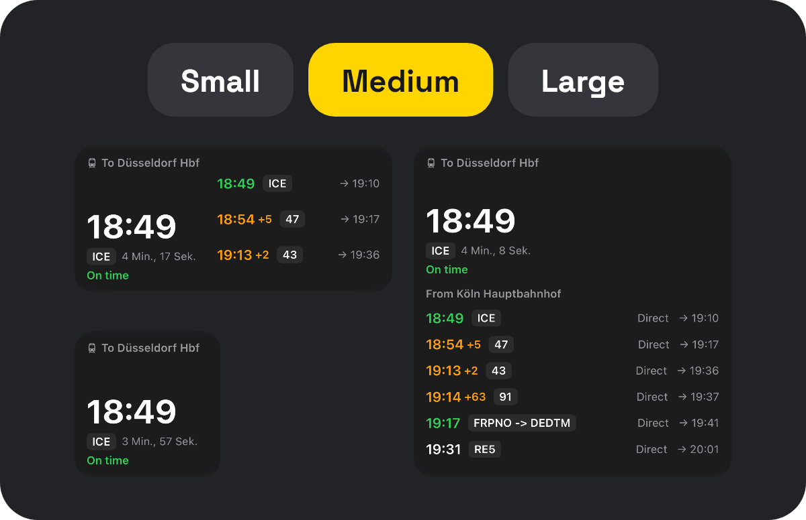
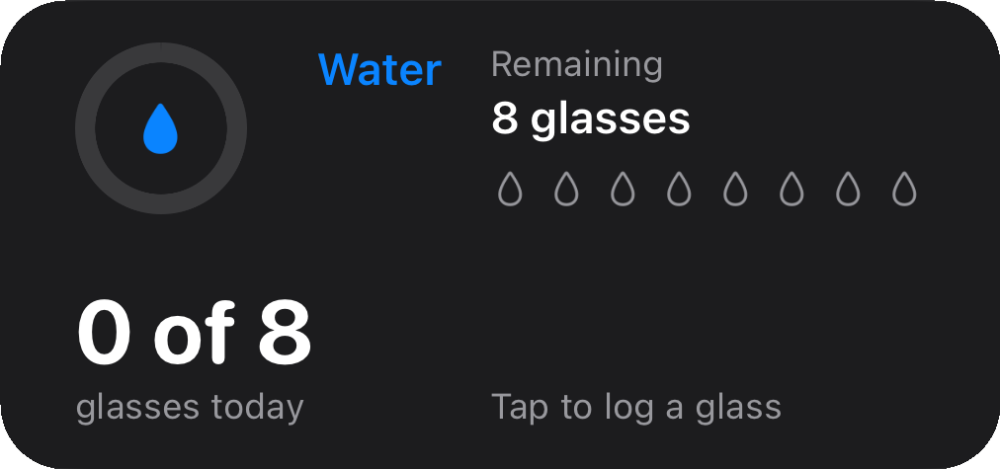
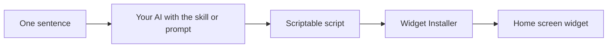

<h1 align="center">words2widget</h1>

  <strong>Say what you want on your iPhone home screen. Your AI builds the widget.</strong> 
  No coding. Just a sentence. Works with ChatGPT, Gemini, Claude and more.

  
  

  

## Make the widget you always wanted

Most widgets show you numbers. Yours can answer your questions.

<h3 align="center">It answers your question</h3>

Ask something real and get a clear answer at a glance, right on your home screen.

  
  

<h3 align="center">It fits your home screen</h3>

Small, medium or large. The layout adapts to the size you pick.

  

<h3 align="center">It's built around your life</h3>

Your calendar, your habits, your next run, the things you care about.

  
  

  
  

<h3 align="center">It works with the AI you already use</h3>

Claude, ChatGPT, Gemini or a free chatbot. No API key, no subscription, no coding.

<strong>Tap any widget to get it.</strong> Got your own idea? Describe it in one sentence, and your AI builds it.

## Quickstart

### Set up once (about five minutes)

1. **Install [Scriptable](https://apps.apple.com/app/scriptable/id1405459188).** It's free.
2. **Copy the Widget Installer.** On your iPhone, open [the installer page](INSTALLER.md) in Safari and tap the copy button on the code block. If it opens in the GitHub app, touch and hold the link and choose **Open in Safari** instead.
3. **Paste it into Scriptable.** Open Scriptable, tap **+** and paste the code. Tap the name at the top, change it to `Widget Installer`, then tap **Done**.
4. **Teach your AI.** Pick the one you use:
   - **Claude:** Download [`scriptable-widget.zip`](https://github.com/veritatron/words2widget/releases/latest/download/scriptable-widget.zip) and upload it in Claude's settings under skills.
   - **ChatGPT, Gemini or any other AI:** Paste the block from [`PROMPT.md`](PROMPT.md) into a new chat.

### Make a widget

1. **Say what you want.** Your AI asks which language and style you'd like.
2. **Copy the code** with the copy button.
3. **Run Widget Installer** in Scriptable and tap **Save**.
4. **Put it on your home screen.** Touch and hold the home screen, tap **Edit**, then **Add Widget**, and choose **Scriptable**. Tap the new widget and pick your script.

## Not sure what to ask for?

Steal one of these:

- "Is it barbecue weather this weekend?"
- "Should I bike or take the bus today?"
- "Do I need sunscreen at noon?"
- "How much of this week is already over?"
- "How many days until my next vacation?"
- "How much of my day is still free?"

Change a color, swap the language, make it weird. If you don't like it, just tell your AI.

## Questions

**Do I need to know how to code?**
No. You never have to read or change the code.

**Is it safe?**
Widget Installer only saves code you hand to it. It never runs that code and never downloads anything.

**What does it cost?**
Scriptable is free, and there are no API keys to pay for. `PROMPT.md` is made to fit free chatbots. Uploading skills depends on your Claude plan.

**It says "No widget found".**
Part of the code is probably missing. Use the copy button on the code block and try again.

**My widget isn't updating.**
iOS decides when widgets refresh, so it can take a while.

## For developers

### How it works

The design follows a few deliberate decisions:

- **No backend and no API keys.** People use the AI app they already have, so the project has no running costs and no secrets to leak.
- **Works with any AI.** The Claude skill and the copy-paste prompt share the same rules, and the installer doesn't care where the code came from.
- **Safe by construction.** The installer only saves code. It never runs received code or downloads anything, and CI fails if it ever tries.
- **One file per widget.** Scriptable has no build step or packages, so every example stays self-contained and easy for an AI to adapt. Shared structure comes from one template.

### Quality

Scriptable only runs on iOS, so checks happen in two layers:

- **On every pull request:** [`scripts/check.mjs`](scripts/check.mjs) parses each script and enforces the platform rules. It blocks unavailable APIs, requires the template's essentials, and ignores comments and strings to avoid false alarms. It has no dependencies.
- **On a real iPhone:** Every example and the full flow from sentence to widget were tested on a device, including with ChatGPT and Gemini.

### Project structure

| Path | What's inside |
|---|---|
| [`skills/scriptable-widget/SKILL.md`](skills/scriptable-widget/SKILL.md) | The source of truth for all widget rules |
| [`PROMPT.md`](PROMPT.md) | The same rules for any chatbot |
| [`scriptable/Widget Installer.js`](scriptable/Widget%20Installer.js) | Saves generated code as a new script |
| [`examples/`](examples) | Ready-made widgets with screenshots |
| [`scripts/check.mjs`](scripts/check.mjs) | Static checks, run with `node scripts/check.mjs` |

---

  Released under the <a href="LICENSE.txt">MIT License</a>.  
  Developed by  
  <a href="https://github.com/veritatron">
    <picture>
      <source media="(prefers-color-scheme: dark)" srcset="assets/veritatron-dark.svg">
      
    </picture>
  </a>

