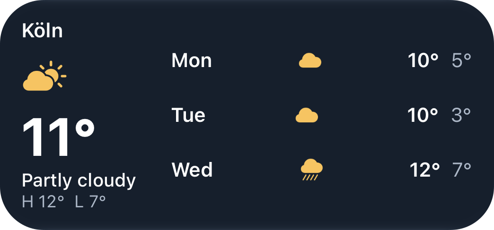
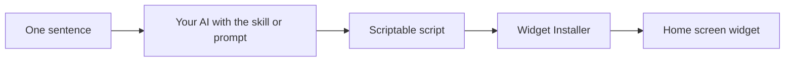

<h1 align="center">words2widget</h1>

  <strong>Say what you want on your iPhone home screen. Your AI builds the widget.</strong> 
  No coding. Just a sentence.

  
  

  

## Widgets that answer your questions

Your weather app shows you numbers. These tell you what to do.

  
  
  
  
  
  

Every one of these started as a single sentence. Yours can be next.

## Get started

You only set this up once. It takes about five minutes.

**1. Get the free [Scriptable](https://apps.apple.com/app/scriptable/id1405459188) app.**

**2. Add the Widget Installer.** On your iPhone, open [this code](https://raw.githubusercontent.com/veritatron/words2widget/master/scriptable/Widget%20Installer.js) in Safari. Touch and hold the text, tap **Select All**, then **Copy**. In Scriptable, tap **+**, paste it and name the script `Widget Installer`.

**3. Teach your AI.** Pick the one you use:

- **Claude:** Download [`scriptable-widget.zip`](https://github.com/veritatron/words2widget/releases/latest/download/scriptable-widget.zip) and upload it in Claude's settings under skills.
- **ChatGPT, Gemini or any other AI:** Paste the block from [`PROMPT.md`](PROMPT.md) into a new chat.

That's it. You're ready.

## Make your first widget

1. **Say what you want.** Your AI asks which language and style you'd like.
2. **Copy the code** with the copy button.
3. **Run Widget Installer** in Scriptable and tap **Save**.
4. **Put it on your home screen.** Touch and hold the home screen, tap **Edit**, then **Add Widget**, and choose **Scriptable**. Tap the new widget and pick your script.

## Not sure what to ask for?

Steal one of these:

- "Is it barbecue weather this weekend?"
- "Should I bike or take the bus today?"
- "Do I need sunscreen at noon?"
- "How much of this week is already over?"
- "How many days until my next vacation?"
- "How much of my day is still free?"

Change a color, swap the language, make it weird. If you don't like it, just tell your AI.

## How it works

The design follows a few deliberate decisions:

- **No backend and no API keys.** People use the AI app they already have, so the project has no running costs and no secrets to leak.
- **Works with any AI.** The Claude skill and the copy-paste prompt share the same rules, and the installer doesn't care where the code came from.
- **Safe by construction.** The installer only saves code. It never runs received code or downloads anything, and CI fails if it ever tries.
- **One file per widget.** Scriptable has no build step or packages, so every example stays self-contained and easy for an AI to adapt. Shared structure comes from one template.

## Quality

Scriptable only runs on iOS, so checks happen in two layers:

- **On every pull request:** [`scripts/check.mjs`](scripts/check.mjs) parses each script and enforces the platform rules. It blocks unavailable APIs, requires the template's essentials, and ignores comments and strings to avoid false alarms. It has no dependencies.
- **On a real iPhone:** Every example and the full flow from sentence to widget were tested on a device, including with ChatGPT and Gemini.

## Project structure

| Path | What's inside |
|---|---|
| [`skills/scriptable-widget/SKILL.md`](skills/scriptable-widget/SKILL.md) | The source of truth for all widget rules |
| [`PROMPT.md`](PROMPT.md) | The same rules for any chatbot |
| [`scriptable/Widget Installer.js`](scriptable/Widget%20Installer.js) | Saves generated code as a new script |
| [`examples/`](examples) | Ready-made widgets with screenshots |
| [`scripts/check.mjs`](scripts/check.mjs) | Static checks, run with `node scripts/check.mjs` |

## Questions

**Do I need to know how to code?**
No. You never have to read or change the code.

**Is it safe?**
Widget Installer only saves code you hand to it. It never runs that code and never downloads anything.

**What does it cost?**
Scriptable is free, and there are no API keys to pay for. `PROMPT.md` is made to fit free chatbots. Uploading skills depends on your Claude plan.

**It says "No widget found".**
Part of the code is probably missing. Use the copy button on the code block and try again.

**My widget isn't updating.**
iOS decides when widgets refresh, so it can take a while.

---

  Released under the <a href="LICENSE.txt">MIT License</a>.  
  Developed by  
  <a href="https://github.com/veritatron">
    <picture>
      <source media="(prefers-color-scheme: dark)" srcset="assets/veritatron-dark.svg">
      
    </picture>
  </a>

